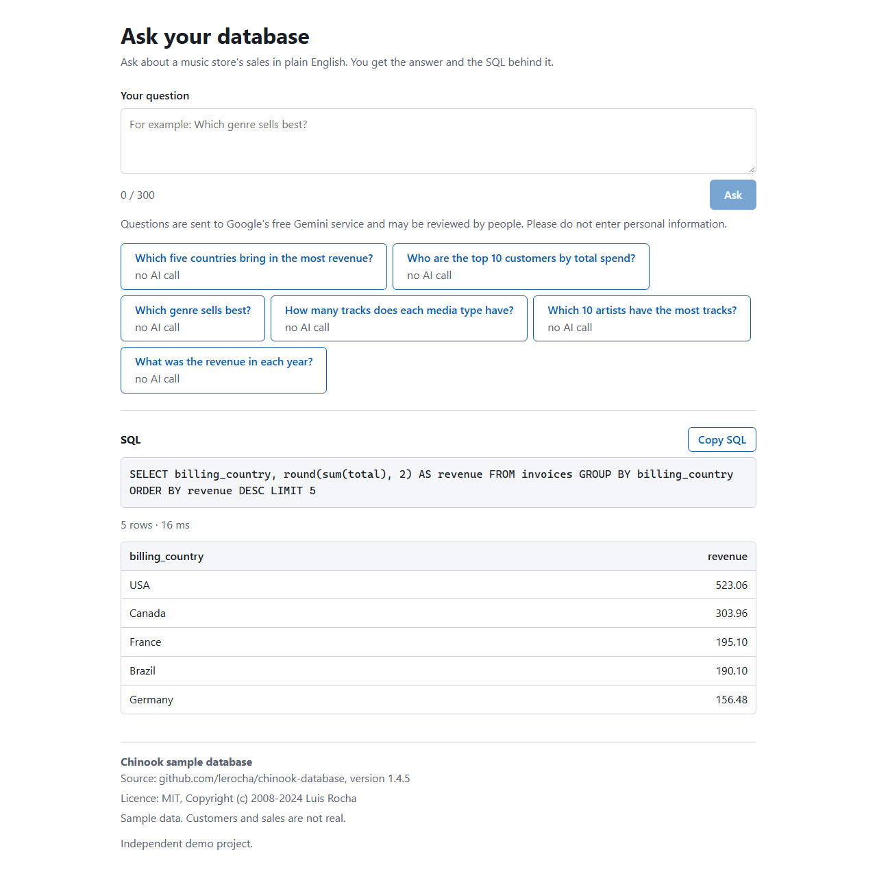

# Ask your database

Ask a question about a music store's sales in plain English. The app writes the SQL, checks it, runs it against a read-only copy of the data, and shows you the answer together with the SQL that produced it, so you can verify the work instead of trusting it.

Live demo: not deployed yet



## Try it

Six example questions are built into the page. Each is a stored question with a stored query, answered from the database once per server start and then kept in memory. They make no model call:

- Which five countries bring in the most revenue?
- Who are the top 10 customers by total spend?
- Which genre sells best?
- How many tracks does each media type have?
- Which 10 artists have the most tracks?
- What was the revenue in each year?

Anything you type yourself goes to the language model (up to 300 characters). Opening `/?example=1` shows the first example directly.

## How it works

1. You type a question.
2. The model (Gemini, behind a small provider interface) is given the table structure and column descriptions, never any data rows, and writes one `SELECT`.
3. A Postgres-aware parser checks that the text is exactly one read-only query on the approved views.
4. The query runs as a read-only database role, inside a read-only transaction, with a time limit and a row limit.
5. The page shows the answer and the SQL. If the database rejects the query, the error is passed back to the model once for a retry. If the database cannot be reached at all, the page says so and no retry is made.

```
question -> model writes SQL -> parser checks -> read-only database -> answer + SQL
                  ^                                      |
                  +------- one retry with the error -----+
```

## Safety

The layers overlap, but they are not interchangeable. The database role stops writes to tables and views and reads of the raw tables. The read-only transaction and the extended protocol are separate barriers to a write: the transaction refuses any change, and the extended protocol makes the server refuse a second, stacked statement. The role refuses temporary tables (the loader revokes that right), and the read-only transaction refuses large objects such as `lo_create`. The validator is what keeps generated SQL off the system catalogue tables and away from blocked functions, because the role can still read `pg_catalog` and `information_schema` by default. Sleep-style functions are refused by the validator and also bounded by the 5 second timeout.

The validator uses a JavaScript SQL parser, and a parser can read SQL differently from Postgres. It already did once, for `U&` unicode-escaped names, which is now guarded. So the validator fails closed on anything it cannot parse. Behind it, the role, the read-only transaction and the extended protocol are three separate barriers to a write, and each is tested on its own.

| Layer | What it does |
|---|---|
| Database role | The app connects as `app_readonly`, which has `SELECT` on 11 described views in an `app` schema and no rights on the raw tables or any write. On its own it stops writes to tables and views and reads of the raw tables, and it has no right to create temporary tables. It does not stop catalogue reads, and it does not stop large objects such as `lo_create` by itself inside a read-write transaction (the read-only transaction does). A separate owner role is used only by the loader. |
| Validation | Exactly one `SELECT` (or `WITH ... SELECT`) is accepted. Writes, DDL, admin commands, catalogue reads, other schemas and blocked functions such as `pg_sleep` and `set_config` are refused. This is the layer that stops catalogue reads and blocked functions. |
| Database limits | `BEGIN READ ONLY` (stops writes), the extended protocol (one statement per query, so a stacked second statement is refused), a 5 second statement timeout (bounds slow queries, including sleeps), at most 200 rows, and a result size limit of about 1 MB of row text that Postgres enforces before anything is sent to the server process (the JSON response can be larger, see Known limits). |
| What the model sees | Structure and column descriptions only. The question is marked as a question, not as instructions. Personal-looking columns (addresses, phone numbers, email) are not exposed in the views at all. |
| Failure handling | A plain message, and at most one automatic retry. Server faults return a generic message, not internals. |

The server also sets these HTTP security headers on every response: `X-Content-Type-Options: nosniff`, `X-Frame-Options: DENY`, `Referrer-Policy: no-referrer`, and a Content-Security-Policy limited to the page's own origin (no `<base>` tag, forms post only to the same origin). The API tests check that they are present.

What is tested (counts are in "How it was verified" below):

- **Validator:** 257 rejection cases (stacked statements, writes inside CTEs, comment tricks, `U&` escapes that hide a function name, catalogue and `pg_` access, and more) and 33 accept cases.
- **Read-only role:** every attack statement is run twice, once normally and once inside an explicit `READ WRITE` transaction, so the grants are shown to hold without help from the read-only default. A direct read of a raw table is denied, and so is creating a temp table. A separate group of tests records what the role does not stop (`pg_notify`, advisory locks and `lo_create` inside a read-write transaction).
- **Executor:** timeout, row cap, result size limit, refusal of stacked statements, no state leaking between requests, no connection details in error messages.
- **Rate limit and daily cap:** unit tests plus API tests, including that a refused request does not use up the daily cap.

## Cost control

- A per-client rate limit (5 requests a minute by default, `RATE_LIMIT_PER_MINUTE`).
- A daily cap on model calls (200 by default, `DAILY_LLM_CAP`).
- Six cached example answers that never call the model.
- Length limits: 300 characters for a question, a 4 KB request body, 2,048 output tokens for the model, 2,000 characters for a generated query, and about 1 MB of result text.
- The Gemini key is meant to live in a Google project with no billing attached, so going over the free quota makes calls fail instead of costing money.

The rate limiter and the daily cap live in the server's memory. They reset when the container restarts, so they are for friendliness and for stopping a burst. The no-billing key is meant to be the real ceiling, because a key from a project with no billing cannot be charged. That is Google's behaviour and was not tested here.

## Stack and why

- **Node 24, TypeScript, Express:** one small server for the API and the built page, with few dependencies.
- **`pgsql-ast-parser`:** a pure JavaScript parser for PostgreSQL, so there is no native build and it behaves the same on Windows and in the container.
- **`pg`:** the plain driver, with an explicit transaction for every query.
- **PostgreSQL 16:** the Chinook data and the read-only role. Docker locally, Neon's free plan in production.
- **React 19 and Vite:** a single page, about 71 kB gzipped, and it loads nothing from other sites (the page is served with a Content-Security-Policy limited to its own origin).
- **Gemini free tier, via plain `fetch`:** no SDK to keep up with, easy to fake in tests. A second provider can be added behind the same interface.
- **vitest and supertest:** server tests run against a real local Postgres, not a mock.
- **Docker:** one image runs the API and the page.

## Run it locally

You need Node 24, Docker, and [uv](https://docs.astral.sh/uv/) (it runs the Python loader and fetches its one dependency). Commands below are for a Bash shell; PowerShell notes follow.

1. Install and configure:
   ```bash
   npm install
   cp .env.example .env
   ```
   Edit `.env`: set `READONLY_PASSWORD` to a strong value (at least 12 characters, not `change-me`), put the same value in `DATABASE_URL_READONLY`, set `POSTGRES_PASSWORD` and put it in `DATABASE_URL_OWNER`. To run without a Gemini key, set `LLM_PROVIDER=fake`; the model then always answers with one fixed query, which is enough to see the page work.
2. Start the database (port 5433, bound to this machine only):
   ```bash
   npm run db:up
   ```
3. Download the Chinook script (MIT, version 1.4.5) and load it. The loader needs the variables from `.env` in its environment:
   ```bash
   mkdir -p data/raw
   curl -L -o data/raw/Chinook_PostgreSql.sql https://github.com/lerocha/chinook-database/releases/download/v1.4.5/Chinook_PostgreSql.sql
   set -a; . ./.env; set +a
   uv run --with "psycopg[binary]" python data/load_chinook.py
   ```
   It prints `customers loaded: 59`. Running it again is safe. For a database that is not on `localhost` it refuses to run unless you add `--confirm`, because it drops and recreates the 11 Chinook tables.
4. Run the tests. **They need the loaded database from step 3.**
   ```bash
   npm test
   ```
5. Start the app. Two terminals for development (the page on http://localhost:5173, proxying `/api` to the server on port 8080):
   ```bash
   npm run dev:server
   npm run dev:web
   ```
   Or build once and serve everything from port 8080:
   ```bash
   npm run build
   npm start
   ```

PowerShell: replace `cp` with `Copy-Item`, and load `.env` for the loader with:
```powershell
Get-Content .env | Where-Object { $_ -match '^[A-Za-z_]+=' } | ForEach-Object { $k, $v = $_ -split '=', 2; Set-Item "env:$k" $v }
```

## Deployment

The pattern is one container, a managed Postgres and a free model key. Nothing is deployed yet.

1. **Database:** create an empty Postgres database on Neon's free plan. Run the loader against it with the owner connection string and `--confirm`, and a strong `READONLY_PASSWORD`. The app then uses only the read-only role's connection string.
2. **Model key:** create a Gemini API key in a Google Cloud project that has no billing attached. Check the free-tier model names and limits on Google's rate-limit page, and set `GEMINI_MODEL` to a listed model (the default in the code is `gemini-2.5-flash-lite`, which is a configuration value, not a promise).
3. **Container:** `docker build -t ask-your-database .`, then deploy the image to Cloud Run with `--max-instances 1` so the in-memory guards stay meaningful, and pass `DATABASE_URL_READONLY`, `GEMINI_API_KEY`, `DAILY_LLM_CAP` and `RATE_LIMIT_PER_MINUTE` as environment values. Set `DAILY_LLM_CAP` to at most half of the real daily model limit (see Known limits).
4. **Check:** `node scripts/smoke-live.mjs <service URL>` runs five checks (health, page assets, a cached example, one live question, and an unsafe question that must not be obeyed).

## Known limits

- **A valid query can still answer the wrong question.** The SQL is shown so you can check it.
- **Some valid read-only SQL is refused.** `INTERSECT`, `EXCEPT`, `SELECT INTO`, `EXPLAIN`, `COPY` and a first query wrapped in brackets are rejected by the parser. The app fails closed rather than guess.
- **The validator relies on a JavaScript SQL parser** that can read SQL differently from Postgres (it differed once, for `U&` unicode-escaped names, which is guarded). It fails closed on anything it cannot parse. If it were fooled, the role, the read-only transaction and the extended protocol are three separate barriers to a write.
- **Duplicate output column names are rejected.** Two columns both called `id` produce a hint to give each column an alias, and the retry can fix it (not measured).
- **A database error can echo a value from the data** into the retry prompt (for example a bad-cast message). The error text is flattened to one line and capped at 300 characters.
- **The daily cap and rate limiter are in memory** and reset whenever the container restarts, including after every scale to zero. The cap is a friendliness guard; the Gemini key's own quota is the real ceiling.
- **Per-visitor limiting is keyed on the client address.** Someone who can rotate addresses (IPv6 in particular) can get around it.
- **The first request after the database has been idle takes longer** while it wakes. The pools wait up to 15 seconds for a connection. The delay was not measured.
- **Metadata functions still answer.** `version()`, `to_regclass()` and similar calls are allowed, because they return metadata only and no data from the tables.
- **Temp tables and large objects:** the role refuses temporary tables, and the read-only transaction refuses large objects (see the role row above). `pg_notify` and advisory locks are not stopped by either, so only the validator, which blocks calls to `pg_` functions by name, keeps them out. They do not change the stored data.
- **Results are limited to about 1 MB of text** (and 200 rows), measured over the whole row in Postgres. A larger answer is refused with a message to ask for fewer rows or shorter columns. The JSON sent to the browser can be larger than that figure, because binary (`bytea`) values are sent as arrays of numbers.
- **One question can cost two model calls** (the first try and the retry), but the daily cap counts one. Set the cap to at most half of the real model limit.
- **Privacy:** on the Gemini free tier, Google may use questions to improve its products and they may be read by people. The page tells visitors not to enter personal information.
- **The data is a sample database.** Its customers and sales are not real.
- **Types in the JSON:** numeric values from the database arrive as text (to keep exact decimals) and dates as ISO strings. The page right-aligns numeric-looking text and shows dates plainly.
- **Query cost is bounded by limits, not prevented.** Only the 5 second timeout and the result size limit bound what a query costs; the role does not. An expensive but read-only query runs until the timeout cuts it off.

## How it was verified

All figures are from runs on a Windows machine with Node 24.19.0 and Docker 29.7.2. Anything not listed here is not measured.

| Fact | Result | Source |
|---|---|---|
| Server tests | 526 passed, 18 files | `npm test` (needs the loaded local database) |
| Web tests | 43 passed, 3 files | `npm test` |
| Total tests | 569 | server and web above |
| Validator cases | 297 (257 rejection, 33 accept, 7 output checks) | vitest JSON report for `server/test/validator.test.ts`, grouped by test group |
| Read-only role tests | 20 | `server/test/readonly-role.test.ts` |
| JavaScript bundle | 71.02 kB gzip (226.23 kB raw) | `npm run build` output, Vite; `gzip -9` gives 70,086 bytes |
| Docker image | 348 MB on disk | `docker images ask-your-database:local` |
| Stored example answer | the first run took 12 ms locally (one measurement); later requests are served from memory | `elapsedMs` from `/api/examples/1/answer` on the local container |
| Smoke script | 5 of 5 checks pass | `node scripts/smoke-live.mjs` against the local container with the fake model |
| Database | Chinook 1.4.5, 11 tables, 11 views, 10,111 kB | `pg_database_size`; largest views: `playlist_tracks` 8,715 rows, `tracks` 3,503, `invoice_lines` 2,240, `invoices` 412 |
| Gold answers | 10 golden questions, each with a view-based and an independent raw-table query that agree | `server/test/golden.test.ts` |

Not measured: model accuracy, live latency, cold start, Lighthouse scores, and behaviour on a real phone (the page was checked in headless Chrome at 360 pixels wide, in light and dark themes, where the table scrolls inside its box and the page does not widen).

**Model accuracy.** The ten golden questions can be run against the real model with your own key.
Put the key in the environment of that one command without typing it into the command line, so it stays out of your shell history. The prompt line must be the last line of its block: run the first block, type the key and press Enter, and only then run the second block. Pasting both at once can feed the next line to the prompt as the key.

In Bash:
```bash
read -rs GEMINI_API_KEY; export GEMINI_API_KEY
```
```bash
npm run golden:live -w server
unset GEMINI_API_KEY
```
In PowerShell:
```powershell
$secure = Read-Host -AsSecureString "Gemini API key"
```
```powershell
$env:GEMINI_API_KEY = [System.Net.NetworkCredential]::new('', $secure).Password
npm run golden:live -w server
Remove-Item Env:GEMINI_API_KEY
```
Do not paste the key into the README, a `.env` file that is committed, an issue or a chat.

The run prints a line per question and a final score, quoted as "matches the gold answers after rounding fractions to 2 decimals". Ties at the edge of a top-10 list and a few phrasing differences can make a correct answer count as a difference, so read the printed SQL for any miss. No score is claimed here because it has not been run.

## Data credit and licence

The data is the Chinook sample database, version 1.4.5, MIT licence, Copyright (c) 2008-2024 Luis Rocha: https://github.com/lerocha/chinook-database

This project is MIT licensed. See [LICENSE](LICENSE).
